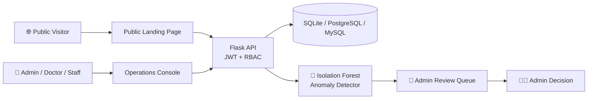

<div align="center">

# 🛡️ Cyber-Pulse

### Zero Trust security meets healthcare operations — powered by machine learning.

**Detect suspicious activity before it becomes a breach. Protect patient data without slowing care down.**


</div>

---

## 🚨 Why Cyber-Pulse?

Hospitals hold some of the most sensitive data in the world — and they are one of the most targeted industries. Most systems either **trust too much** or **block too aggressively**.

Cyber-Pulse takes the middle path:

> 🔍 **Watch every action → 🧠 Score it with ML → 🧑‍⚖️ Let a human decide.**

Suspicious behaviour is flagged for admin review — **never auto-punished**. Accounts are blocked only when an administrator explicitly says so.

---

## ✨ Highlights

| | Feature | What it does |
|---|---|---|
| 🧠 | **ML Anomaly Detection** | Isolation Forest pipeline flags unusual user activity in real time |
| 🔐 | **JWT + RBAC** | Short-lived access tokens with Admin / Doctor / Staff roles |
| 🧱 | **Least-Privilege Endpoints** | Clinical APIs expose only what each role needs |
| ♻️ | **Session Revocation** | Kill a compromised session instantly |
| 🚫 | **Account Blocking** | Admin-controlled, never automatic |
| 🛑 | **Login Rate Guard** | Slows down brute-force attempts |
| 🧾 | **Security Headers** | Hardened HTTP response headers out of the box |
| 🔄 | **Server-Side Role Revalidation** | Roles are re-checked on the server, not trusted from the client |
| 📊 | **Role-Aware Dashboards** | Each user sees the console built for their job |
| 🌐 | **Public Patient Website** | Safe, non-sensitive hospital landing page with an enquiry form |

---

## 🏗️ Architecture



### 🧰 Tech Stack

| Layer | Technology |
|---|---|
| **Backend** | Flask, SQLAlchemy, JWT, RBAC |
| **Machine Learning** | Isolation Forest anomaly detection |
| **Frontend** | React, Vite, React Router, Recharts, Lucide |
| **UI** | Handcrafted enterprise healthcare/security design system — zero UI-framework dependency |
| **Database** | SQLite by default · PostgreSQL / MySQL via `DATABASE_URL` |

---

## ⚡ Quick Start

### 1️⃣ Run the backend

```bash
python -m venv .venv

# Windows
.venv\Scripts\activate
# macOS / Linux
source .venv/bin/activate

pip install -r requirements.txt
python run.py
```

### 2️⃣ Run the React UI (development)

```bash
cd frontend
npm install
npm run dev
```

> Vite proxies `/api` to `http://localhost:5000`.

### 3️⃣ Build the UI for production

```bash
cd frontend
npm run build
```

The build lands in `app/static/dist`, and Flask serves the SPA for every non-API route. **One server, one deploy.**

---

## 🔑 Demo Accounts

| Role | Username | Password |
|---|---|---|
| 👑 Admin | `admin` | `Admin@123` |
| 🩺 Doctor | `doctor` | `Doctor@123` |
| 🧑‍💼 Staff | `staff` | `Staff@123` |

> ⚠️ **Demo only.** Change all seeded credentials before any real deployment.

---

## 🔒 Security Model

Cyber-Pulse is designed around **Zero Trust** — nothing is trusted just because it logged in once.

- **Short-lived access tokens** with session revocation
- **Admin-only account provisioning** — public login works for demo accounts, but new accounts can only be created by an administrator
- **Non-destructive detection** — suspicious or critical activity creates an *admin-review event*; only an explicit administrator action blocks an account
- **Non-destructive simulation** — the attack simulation never damages real data
- **Server-side role revalidation** on protected requests

### Production checklist

Set these as environment variables:

| Variable | Purpose |
|---|---|
| `SECRET_KEY` | Flask application secret |
| `JWT_SECRET_KEY` | Token signing key — use **at least 32 bytes** |
| `DATABASE_URL` | Point to PostgreSQL / MySQL instead of SQLite |

> 💡 In local development, an omitted `JWT_SECRET_KEY` is generated randomly at startup, so restarting Flask invalidates existing login tokens. Always set a stable key in production, and serve behind **HTTPS**.

---

## 🌐 Public Patient Website

`/` is the public, patient-facing hospital landing page — intentionally separate from the authenticated operations console at `/dashboard`.

It exposes **only non-sensitive information**:

| Method | Endpoint | Purpose |
|---|---|---|
| `GET` | `/api/public/departments` | List hospital departments |
| `GET` | `/api/public/doctors` | List doctors |
| `POST` | `/api/public/inquiries` | Submit a general enquiry |

**The enquiry endpoint is locked down:**

- ✅ Accepts only name, email, phone, department and a general message
- ❌ Rejects clinical fields
- ✅ Server-side input validation and field length limits
- ✅ Department checked against the database
- ✅ Rate-limited public submissions

> 🚫 **Never** put diagnoses, prescriptions, medical record numbers, or other sensitive clinical information into the public enquiry form.

---

## 📸 Screenshots

<!-- Add your screenshots here — they make the biggest difference! -->
| Public Landing Page | Operations Dashboard | Anomaly Review |
|---|---|---|
| _screenshot_ | _screenshot_ | _screenshot_ |

---

## 🗺️ Project Structure

```text
cyber-pulse/
├── app/                # Flask backend (API, models, auth, ML detector)
│   └── static/dist/    # Built React UI served by Flask
├── frontend/           # React + Vite source
├── requirements.txt
└── run.py
```

> Adjust the tree above to match your actual folders.

---

<div align="center">

### ⭐ If Cyber-Pulse helped or inspired you, give it a star!

Built with 🛡️ by **KLI888**

</div>
